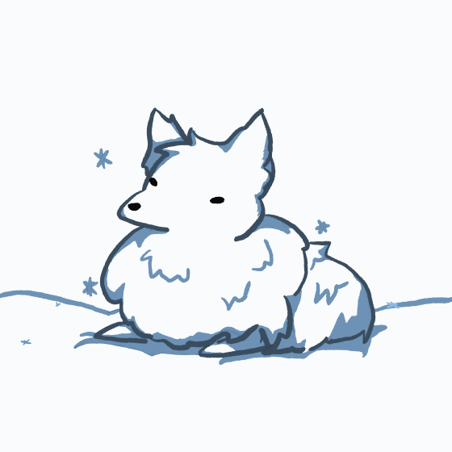

Machine Learning and Statistics graduate ([UdeM](https://www.umontreal.ca/) & [Mila](https://mila.quebec/) MSc, [McGill](https://www.mcgill.ca/) BSc) exploring how [multi-agent systems](https://en.wikipedia.org/wiki/Multi-agent_reinforcement_learning) and conversational AI learn through interaction. Currently building cooperative simulations in [Gymnasium](https://gymnasium.farama.org/index.html) and [MuJoCo](https://mujoco.org/) alongside an early-stage agentic conversational AI prototype that adapts from zero context.

---

## Current Work

**Freelance AI Trainer & Model Evaluator** \| Self-Employed \| 2026–Present
- Assessing and ranking LLM responses (RLHF) across logical reasoning, Python code correctness, and safety rubrics to improve alignment and quality, documenting stability issues with multi-turn adversarial prompts and Python verification checks.
- Fact-checking model outputs against primary sources to catch subtle hallucinations and constraint violations under structured evaluation guidelines.

**Co-Founder — Agentic Conversation Partner** \| Early-Stage Startup \| 2026–Present
- Developing a general conversational partner that adapts and questions user thinking through proactive dialogue and reflective feedback within a multi-agent RL environment from zero context.
- Analyzing agent behavior, alignment, model architecture evolution, and failure states to monitor and stabilize long-term consistency and variability.

**Multi-Agent Simulation and Interactions** \| Independent Research \| 2024–Present
- Simulating cooperative and adversarial agent movements in [Gymnasium](https://gymnasium.farama.org/index.html) and [MuJoCo](https://mujoco.org/) using self-supervised RL with simple random environments and structured tasks.
- Testing policies against instability and reward-hacking failure modes under shifting dynamics.

**Prediction Market Tool** \| [Open Source Application](https://github.com/Jawing/predict) \| 2026–Present
- Built a Python CLI analysis tool querying live prediction market APIs to estimate calibrated probabilities, evaluating statistical edge and tracking user forecasting accuracy over time.

---

## Past Work & Projects

**Machine Learning Researcher Intern** \| Humanware, Longueuil, QC \| 2022–2023 [<i class="fa-solid fa-file"></i>](./papers/Humanware_Internship_Report.pdf)
- Trained and evaluated object detection models (RegionCLIP), improving out-of-distribution generalization in unfamiliar environments.
- Built an Android voice-guidance prototype for visually impaired users with continual-learning data collection.

**Multi-Agent RL in PettingZoo** \| UdeM & Mila, Montréal, QC \| 2023 [<i class="fa-solid fa-file"></i>](./papers/RL_Project_paper.pdf) [<i class="fa-brands fa-youtube"></i>](https://youtu.be/U5Z_gL2xs4w)
- Compared DQN and PPO in multi-agent [PettingZoo](https://pettingzoo.farama.org/environments/atari/space_invaders/) Atari environments; analyzed reward shaping, network architectures, and extensions toward self-supervised and offline RL.

**Convolution vs. Attention Generalization** \| UdeM & Mila, Montréal, QC \| 2022 [<i class="fa-solid fa-file"></i>](./papers/Conv_vs_Attention.pdf) [<i class="fa-solid fa-chart-line"></i>](./assets/images/shape-bias.html)
- Benchmarked ResNet, ViT, and ConvNeXt using proxy shape-bias metrics on GAN-stylized images to evaluate representation stability across out-of-distribution visual styles.

**Hockey Goal Prediction Service** \| UdeM & Mila, Montréal, QC \| 2021 [<i class="fa-solid fa-link"></i>](./_posts/2021-11-30-milestone-2.md)
- Deployed an ensemble deep learning prediction API using Flask and Docker with experiment tracking in Comet.ml and interactive Plotly shot heatmaps.

**Toxicity & Fairness Evaluation in Text** \| McGill University, Montréal, QC \| 2019 [<i class="fa-solid fa-file"></i>](./papers/Toxicity_Detection.pdf)
- Evaluated CNN, LSTM, and fine-tuned BERT/GPT models on toxicity classification (ROC-AUC) while optimizing group fairness across identity subgroups.

**Software Engineer Intern** \| Microsoft, Beijing, China \| 2015
- Developed and maintained client-facing web components (HTML, CSS, JavaScript) and prototyped a cross-platform intern social app on Android.

### Additional Experience
- **Summer Camp Counselor** \| Préville Summer Camp (Summer 2023) — Led daily robotics, science, music, dance, and sports activities for children aged 5–12.
- **Orderly** \| [Grace Dart Extended Care Centre (CIUSSS ODIM)](https://www.ciusss-ouestmtl.gouv.qc.ca/installations/chsld/centre-de-soins-prolonges-grace-dart/) (2020–2021) — Supported residents' daily care routines and group activities in a clinical team.
- **Web Dev & IT Support** \| [Centre Saint-Antoine 50+](http://centrestantoine50plus.org/) (2017) & [Age UK](https://www.ageuk.org.uk/) (2016) — Built an accessible senior website and led 1-on-1 tech coaching across PC, Android, and iOS devices.

---

## Education

**[Université de Montréal](https://www.umontreal.ca/) & [Mila](https://mila.quebec/)** \| Professional MSc in Machine Learning \| 2021–2023  
**[McGill University](https://www.mcgill.ca/)** \| BSc in Statistics & Computer Science \| 2015–2019

---

  <a href="https://osu.ppy.sh/home">🎵</a>

---

Past Present Future 
Time Symmetric Mirror 
Aligning with Entropy 
Exploring with Harmony 
Balance Reflective Embrace 
Flow Permeating Space 

---

---
